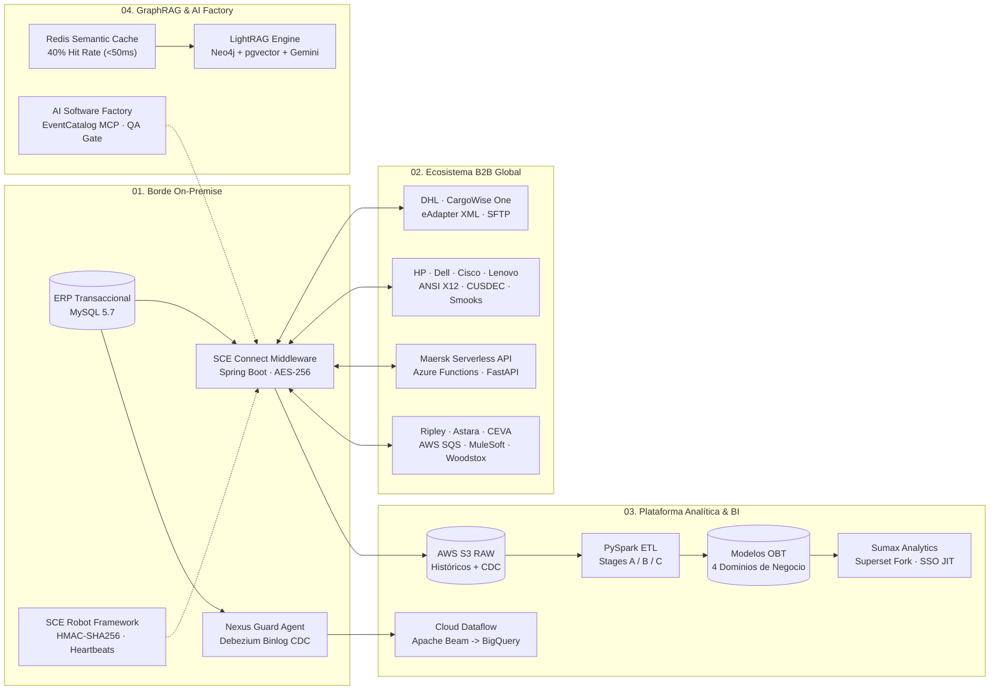

<code>SYSTEMS ARCHITECTURE // ENTERPRISE B2B INTEROPERABILITY // HYBRID GRAPHRAG</code>

# Jesus Sebastian Diez Plasencia

**Tech Lead &amp; Full Stack AI / Cloud Systems Architect**  
`AICSAC & SINTAD (Grupo Empresarial)` &middot; `Lima, Perú`

  <a href="https://jdev-king.github.io"><kbd>Portfolio &amp; Pipeline Interactivo &#8594;</kbd></a>&nbsp;
  <a href="https://jdev-king.github.io/architectures"><kbd>Estudio de Arquitecturas (RFCs) &#8594;</kbd></a>&nbsp;
  <a href="https://www.linkedin.com/in/jesusdiezp/"><kbd>LinkedIn</kbd></a>&nbsp;
  <a href="https://medium.com/@j.diez.plasencia"><kbd>Medium</kbd></a>&nbsp;
  <a href="mailto:jesus.plasencia@sintad.com.pe"><kbd>Contacto Directo</kbd></a>

Arquitecto de software y líder técnico especializado en sistemas distribuidos, plataformas de interoperabilidad empresarial B2B, ingeniería de datos multi-etapa e inteligencia artificial en producción para comercio exterior, aduanas y logística global. Diseño infraestructuras híbridas que conectan sistemas transaccionales on-premise con <strong>Google Cloud, AWS y Microsoft Azure</strong> priorizando latencia determinista, aislamiento Zero-Trust y eficiencia financiera.

<table width="100%">
  <thead>
    <tr>
      <th width="25%" align="left"><code>ESCALA EN PRODUCCIÓN</code></th>
      <th width="25%" align="left"><code>OPTIMIZACIÓN FINOPS IA</code></th>
      <th width="25%" align="left"><code>CAPTURA CDC SIN BLOQUEOS</code></th>
      <th width="25%" align="left"><code>ECOSISTEMA B2B ACTIVO</code></th>
    </tr>
  </thead>
  <tbody>
    <tr>
      <td><strong>33,333 req / día</strong> Inferencia sobre GKE con &lt; 50ms en caché semántico Redis</td>
      <td><strong>-95% en costo mensual</strong> Presupuesto acotado a ~$800 USD/mes con GraphRAG y Gemini Flash</td>
      <td><strong>0.0% DB Locks</strong> Ingesta directa desde Binary Log en MySQL 5.7 con Debezium</td>
      <td><strong>20+ sistemas en vivo</strong> Integraciones para DHL, Maersk, UPS, CEVA, Ripley y Astara</td>
    </tr>
  </tbody>
</table>

---

## `01 // ARQUITECTURA DE REFERENCIA E INTEROPERABILIDAD`

Mapa de los cuatro dominios que dirijo en producción dentro de **AICSAC y SINTAD**: captura e integración en el borde (`On-Premise`), pasarelas B2B para operadores logísticos globales, plataforma analítica multi-etapa (`AWS S3 -> PySpark -> OBTs -> BI`) y plano de inteligencia artificial (`Fortress Lite GraphRAG` + `AI Software Factory`).

---

## `02 // ESPECIFICACIONES DE ARQUITECTURA DESTACADAS (RFCs)`

Documentación pública de ingeniería con diagramas interactivos de arquitectura, secuencia y flujo de datos disponibles en mi portafolio web.

| Especificación | Sistema | Mecanismo Arquitectónico Clave | Impacto Operativo | Estudio Interactivo |
| :--- | :--- | :--- | :--- | :--- |
| **`RFC-AI-301`** v3.1 · GKE | **SINTAD AI Knowledge Agent (Fortress Lite)** | Cortafuegos semántico en Redis que intercepta el 40% del tráfico recurrente en menos de 50ms antes de enrutar hacia agentes LightRAG sobre grafos Neo4j y vectores `pgvector` en CloudNativePG. | `33,333 consultas/día` `-95% costo inferencia` | [Inspeccionar RFC-AI-301 &#8594;](https://jdev-king.github.io/architectures/sintad-ai-agent) |
| **`RFC-ERP-101`** v1.0 · Hybrid | **NexusFlow Hybrid ERP Integration** | Agente Linux Zero-Trust con Debezium embebido que transmite mutaciones hacia Google Cloud Pub/Sub, garantiza idempotencia con bloqueos en Firestore y aplica Claim-Check en Cloud Storage para payloads mayores a 1MB. | `< 25ms p99` `0.0% bloqueos en ERP` | [Inspeccionar RFC-ERP-101 &#8594;](https://jdev-king.github.io/architectures/nexusflow-v1) |
| **`RFC-DATA-201`** v2.0 · Multi-Cloud | **Unified Analytics Bridge** | Pipeline con estado en Google Cloud Dataflow (`Apache Beam Python`) que homologa más de 15 estructuras relacionales legacy hacia un Star Schema en BigQuery, expuesto vía FastAPI al microfrontend Angular en AWS. | `$1.83 a $4.33 USD/mes` `SLA API < 120ms` | [Inspeccionar RFC-DATA-201 &#8594;](https://jdev-king.github.io/architectures/analytics-bridge) |

---

## `03 // PRODUCTOS CORPORATIVOS Y ECOSISTEMAS B2B`

<table width="100%">
  <thead>
    <tr>
      <th width="50%" align="left"><code>PLATAFORMAS Y PRODUCTOS PROPIOS (AICSAC &middot; SINTAD)</code></th>
      <th width="50%" align="left"><code>INTEGRACIONES B2B PARA OPERADORES GLOBALES</code></th>
    </tr>
  </thead>
  <tbody>
    <tr>
      <td valign="top">
        
<strong>PROD-01 &middot; SCE Connect Middleware</strong> 
        Monolito modular en Spring Boot, MyBatis/JPA y Flyway instalado on-premise. Expone APIs REST autenticadas, procesa webhooks bidireccionales (SAP, Zoho CRM) con mapeo dinámico de campos, cifra credenciales externas con AES-256 y extrae datos hacia AWS S3 sin abrir puertos de base de datos a internet.

        
<strong>PROD-02 &middot; Plataforma Analítica Cloud (Stages A/B/C &amp; OBTs)</strong> 
        Pipeline Lakehouse sobre AWS S3 RAW, PySpark (normalización en Stage A, deduplicación CDC y reglas de negocio en Stage B) y Redshift/PostgreSQL (Stage C) que materializa modelos <strong>OBT (One Big Tables)</strong> para Aduanas, Carga, Transporte y Contabilidad.

        
<strong>PROD-03 &middot; Sumax Analytics (Corporate Superset Fork)</strong> 
        Solución corporativa de Business Intelligence mantenida como fork sincronizado de Apache Superset con autenticación <strong>SSO y aprovisionamiento Just-In-Time (JIT)</strong>, desplegada en AWS ECR/EC2 con sidecar TLS en nginx.

        
<strong>PROD-04 &middot; SCE Robot Framework (AWS CodeArtifact)</strong> 
        Librerías Maven transversales en Java 21 y Spring Boot 3.5 con versionado semántico automático. Estandarizan validación entrante <strong>HMAC-SHA256 anti-replay</strong>, caché Caffeine, autenticación saliente polimórfica y latidos de salud cada 5 minutos con Circuit Breaker hacia Cloud Storage.

        
<strong>PROD-05 &middot; AI Software Factory &amp; EventCatalog (v7.2)</strong> 
        Fábrica de desarrollo multi-agente aislada en zonas de confianza (<code>DEV</code> y <code>OPS</code>) sobre contenedores WSL2, gobernada por un catálogo estructural en <strong>EventCatalog + MCP</strong>, ruteo en LiteLLM y puerta determinista de QA (Playwright, Gitleaks y revisión cruzada).

      </td>
      <td valign="top">
        
<strong>B2B-01 &middot; Ecosistema DHL Global Forwarding (8 Sistemas)</strong> 
        Sincronización bidireccional con <strong>CargoWise One</strong> mediante protocolo <code>eAdapter XML</code> sobre SFTP y JAXB; traductor <strong>EDI X12 214 y EDIFACT CUSDEC</strong> con <code>Smooks Framework</code> para <strong>Hewlett-Packard</strong>; procesamiento XML/SFTP para <strong>Schneider Electric, Lenovo y Epiroc</strong>; y orquestación contable batch con <strong>JBA</strong>.

        
<strong>B2B-02 &middot; Maersk Serverless Customs API</strong> 
        Intermediario serverless en <strong>Azure Functions + Python 3.11 FastAPI</strong> protegido con Azure AD, API Management, Key Vault y Rate Limiting para consulta en tiempo real sobre infraestructura Oracle Cloud.

        
<strong>B2B-03 &middot; UPS &middot; Cisco, Dell &amp; FGV Service Envelope (3 Sistemas)</strong> 
        Plataformas multi-módulo en Java 21 y Spring Boot 3.5 con descarga SFTP por lotes cada 30s, lectura XML en streaming (<code>StAX</code>), conversión de facturas <code>ANSI X12</code> de Dell con Smooks hacia declaraciones DAM (<code>CUSDEC</code>) y emisión de respuestas <code>CUSRES</code>.

        
<strong>B2B-04 &middot; CEVA Logistics &amp; Pasarela API PML</strong> 
        Intercambio bidireccional SFTP con generación XML estricta en <code>Woodstox</code> (embarques <code>B-File</code> e hitos <code>Milestone</code>), ingesta transaccional anti-duplicados desde hojas de cálculo y API REST pública de consulta aduanera.

        
<strong>B2B-05 &middot; Ripley, Adualink &amp; Transitario Internacional</strong> 
        Recepción asíncrona de órdenes de importación retail mediante <strong>API REST y colas Amazon SQS</strong>, numeración automática multi-empresa, envío SOAP/JAX-WS de pólizas XML y sincronización dual con Infocomex.

        
<strong>B2B-06 &middot; Astara (Kia / GAC) &amp; Boxpool (SAP + MuleSoft)</strong> 
        Automatización de nacionalización automotriz (<code>SAP -&gt; MuleSoft Cloud -&gt; API REST Spring Boot -&gt; ERP</code>) con AWS Secrets Manager, eliminando la transcripción manual de más de 50 atributos técnicos por vehículo.

      </td>
    </tr>
  </tbody>
</table>

---

## `04 // MATRIZ DE DOMINIOS Y TECNOLOGÍAS`

<table width="100%">
  <thead>
    <tr>
      <th width="25%" align="left"><code>IA, GRAPHRAG &amp; AGENTES</code></th>
      <th width="25%" align="left"><code>BACKEND &amp; PROTOCOLOS B2B</code></th>
      <th width="25%" align="left"><code>INGENIERÍA DE DATOS &amp; BI</code></th>
      <th width="25%" align="left"><code>CLOUD, DEVOPS &amp; QA</code></th>
    </tr>
  </thead>
  <tbody>
    <tr>
      <td valign="top">
        <code>Gemini 1.5 / 2.5 Flash</code> 
        <code>Claude Sonnet / Opus</code> 
        <code>LightRAG &amp; LangChain</code> 
        <code>Neo4j Cypher Graph DB</code> 
        <code>CloudNativePG pgvector</code> 
        <code>Redis Semantic Cache</code> 
        <code>LiteLLM &amp; Langfuse</code> 
        <code>EventCatalog &amp; MCP</code>
      </td>
      <td valign="top">
        <code>Java 21 &amp; Spring Boot 3.5</code> 
        <code>Python 3.11+ &amp; FastAPI</code> 
        <code>MyBatis, JPA &amp; Flyway</code> 
        <code>ANSI X12 &amp; EDIFACT Smooks</code> 
        <code>CargoWise eAdapter XML</code> 
        <code>JAXB, StAX &amp; Woodstox</code> 
        <code>MuleSoft &amp; SOAP JAX-WS</code> 
        <code>HMAC-SHA256 &amp; AES-256</code>
      </td>
      <td valign="top">
        <code>PySpark (Stages A/B/C)</code> 
        <code>Apache Beam / Dataflow</code> 
        <code>Debezium Binlog CDC</code> 
        <code>Google BigQuery</code> 
        <code>AWS S3 &amp; Redshift</code> 
        <code>PostgreSQL &amp; MySQL</code> 
        <code>Apache Superset (Fork)</code> 
        <code>Modelado OBT &amp; Star Schema</code>
      </td>
      <td valign="top">
        <code>Google Kubernetes (GKE)</code> 
        <code>Google Cloud Run &amp; Pub/Sub</code> 
        <code>AWS SQS, ECR, EC2, IAM</code> 
        <code>AWS CodeArtifact &amp; Secrets</code> 
        <code>Azure Functions &amp; Key Vault</code> 
        <code>Terraform IaC &amp; Docker</code> 
        <code>GitLab CI/CD &amp; SemRel</code> 
        <code>Playwright, Pytest, Gitleaks</code>
      </td>
    </tr>
  </tbody>
</table>

---

## `05 // TRAYECTORIA DE LIDERAZGO TÉCNICO`

| Periodo | Cargo y Organización | Alcance e Impacto Verificado |
| :--- | :--- | :--- |
| **`2026 - Presente`** | **Tech Lead &amp; Full Stack AI Architect** AICSAC &amp; SINTAD (Grupo Empresarial) | Dirección de arquitectura de los 5 productos corporativos (`SCE Connect`, `Plataforma Analítica OBTs`, `Sumax Analytics`, `SCE Robot Framework`, `AI Software Factory`) y supervisión técnica de más de 20 sistemas de integración B2B en producción. |
| **`2024 - 2025`** | **Full Stack AI Engineer** SINTAD | Diseño y despliegue en GKE de la arquitectura híbrida GraphRAG `Fortress Lite` (`33,333 consultas/día`, `-95%` en costos de inferencia) y extracción documental automatizada con Google Cloud Document AI (`-70%` en tiempo de procesamiento). |
| **`2024`** | **Co-Founder &amp; AI Engineer** Hebrax IMS | Desarrollo integral de plataforma clínica de apoyo al triaje dermatológico y gestión de historias médicas sobre FastAPI, LangChain, Angular y Firebase. |
| **`2022 - 2023`** | **Full Stack Developer** SINTAD | Modernización de módulos críticos del ERP hacia Angular y servicios RESTful en Spring Boot / Kotlin (`-30%` deuda técnica frontend) e implementación de buscadores semánticos internos (`-60%` tiempo de soporte). |
